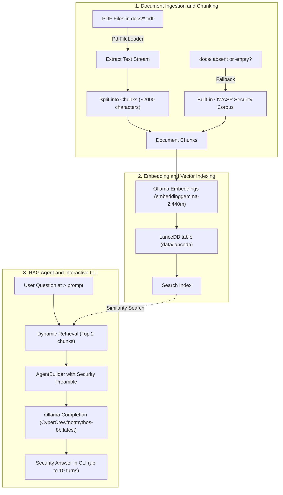

# Security RAG

A local, privacy-focused Security Retrieval-Augmented Generation (RAG) agent built with Rust, the [Rig](https://github.com/0xPlaygrounds/rig) LLM framework, and [Ollama](https://ollama.com/).

This project indexes application security documents (such as OWASP guidelines, vulnerability advisories, and architecture hardening guides) and provides an interactive terminal chatbot to answer security questions with grounded citations. Everything runs 100% locally on your machine—no external API keys, telemetry, or cloud services required.

---

## Architecture & Workflow

The following diagram illustrates the complete end-to-end pipeline from document ingestion to RAG generation:



### Detailed Pipeline Stages

1. **Document Loading**:
   - At startup, the application checks for a `docs/` folder in the project root.
   - If present, it loads all matching `*.pdf` files using `rig::loaders::PdfFileLoader`.
   - If `docs/` is absent or contains no readable PDFs, it falls back to an embedded 5-item OWASP vulnerability corpus so the agent is immediately usable out of the box.

2. **Word-Boundary Chunking**:
   - Extracted document text is processed through a word-boundary chunker with a 2,000-character limit (`CHUNK_SIZE = 2000`).
   - Words are grouped along whitespace breaks to prevent tokens or security terms from being sliced mid-word.

3. **Vector Embeddings**:
   - Each chunk is converted into a `Document { id, content }` and batched into an `EmbeddingsBuilder`.
   - Embeddings are generated locally via the Ollama `/api/embeddings` endpoint using `embeddinggemma-2:440m`.

4. **LanceDB Vector Store**:
   - Embeddings and chunk text are stored in an on-disk [LanceDB](https://lancedb.com/) table (`security_docs`, columns `id`, `content`, `embedding`) under `data/lancedb` (override with `LANCEDB_PATH`).
   - The table is wrapped by `rig-lancedb`'s `LanceDbVectorIndex` to serve similarity search for context retrieval.
   - On later startups the existing table is reused, so documents are not re-read or re-embedded.

5. **Security Agent & Interactive Chatbot**:
   - The RAG agent is instantiated with a security expert system preamble (`You are a security assistant. Answer questions about application security, vulnerabilities, and best practices using the provided context...`).
   - For every question, the agent dynamically retrieves the top 2 most relevant context chunks and passes them to the completion model (`CyberCrew/notmythos-8b:latest` by default).
   - An interactive CLI session allows up to 10 turns of dialogue per execution.

---

## Tech Stack & Dependencies

| Component | Technology | Description |
| :--- | :--- | :--- |
| **Language** | Rust (2021 Edition) | High-performance, memory-safe systems language (`forbid(unsafe_code)`) |
| **LLM Framework** | [Rig](https://github.com/0xPlaygrounds/rig) (v0.46) | Modular LLM framework for agents, embeddings, loaders, and stores |
| **LLM Host** | [Ollama](https://ollama.com/) | Local LLM runner exposing REST endpoints on port 11434 |
| **Embedding Model** | `embeddinggemma-2:440m` | Text embeddings for semantic similarity search |
| **Completion Model**| `CyberCrew/notmythos-8b:latest` | Lightweight completion model suitable for fast local inference |
| **Vector Store** | [LanceDB](https://lancedb.com/) via `rig-lancedb` (v0.46) | Persistent on-disk vector index (`data/lancedb`) |
| **Async Runtime** | Tokio (v1, full) | Multi-threaded asynchronous runtime |
| **Serialization** | Serde / Serde JSON | Data serialization and deserialization |
| **Error Handling** | Anyhow | Context-rich error handling |

---

## File Structure

```
security-rag/
├── docs/                   # Optional: folder for your custom security PDFs
│   └── *.pdf
├── src/
│   └── main.rs             # Application entry point, chunking logic, and RAG pipeline
├── data/lancedb/           # Generated LanceDB vector store (git-ignored)
├── .env / .env.example     # Model, prompt and path configuration
├── Cargo.toml              # Crate manifest, dependencies (rig, rig-lancedb, dotenvy)
├── Cargo.lock              # Reproducible dependency lockfile
├── progress-tracker.md     # Task progress tracker (ASD-STE100 format)
├── .gitignore              # Ignores target/, data/ and .env
└── README.md               # Complete project documentation and workflow guide
```

---

## Prerequisites

1. **Rust Toolchain**: Install [Rust & Cargo](https://rustup.rs/) (1.75+ recommended).
2. **Ollama**: Download and install [Ollama](https://ollama.com/).
3. **Pull Models**: Start Ollama and pull the required default models:

```bash
ollama pull embeddinggemma-2:440m
ollama pull CyberCrew/notmythos-8b:latest
```

*(Optional: You can also use other models such as `bge-m3`, `qwen2.5`, or `llama3.2` via environment variables).*

4. **`protoc` (Protocol Buffers compiler)**: LanceDB's build requires it. Install it (e.g. `choco install protoc`, `brew install protobuf`, `apt install protobuf-compiler`) or download a release from <https://github.com/protocolbuffers/protobuf/releases> and set `PROTOC` to the binary path.
5. **Disk space**: The first build compiles LanceDB/Arrow/DataFusion and needs several GB. If your system drive is low, point cargo elsewhere with `CARGO_TARGET_DIR` (e.g. `D:/cargo-target/security-rag`).

---

## Ingesting Documents (How to Add PDFs)

The system automatically handles chunking and embedding upon startup:

1. **Create the `docs/` folder** in the project root:
   - **PowerShell**:
     ```powershell
     New-Item -ItemType Directory -Name docs
     ```
   - **Bash / Linux**:
     ```bash
     mkdir docs
     ```

2. **Add your PDF files**:
   Place any PDF documents (e.g. security policy, vulnerability guides, audit reports) into `docs/`.

3. **Run the program**:
   ```bash
   cargo run
   ```

At startup, the application outputs:
```text
Loaded 18 security chunks.
Successfully generated embeddings
Starting security RAG chatbot (completion model: CyberCrew/notmythos-8b:latest)...
>
```

> [!NOTE]
> Chunks and embeddings are persisted in LanceDB (`data/lancedb`). If you add or remove PDF files from `docs/`, or change `EMBED_MODEL`, delete the `data/lancedb` folder and restart with `cargo run` to re-chunk and re-embed. On a reused table the app prints `Reusing existing LanceDB table 'security_docs' ...` instead of the "Loaded N chunks" lines.

---

## Build & Run

### Build

```bash
cargo build
```

For an optimized release binary:
```bash
cargo build --release
```

### Run (Interactive CLI)

```bash
cargo run
```

Or run the compiled binary directly:
- **Windows**:
  ```powershell
  .\target\debug\security_rag.exe
  ```
- **Linux / macOS**:
  ```bash
  ./target/debug/security_rag
  ```

### Example Session

```text
Loaded 11 security chunks.
Successfully generated embeddings
Starting security RAG chatbot (completion model: CyberCrew/notmythos-8b:latest)...
> What is SQL injection and how can we prevent it?
SQL injection occurs when untrusted user input is sent directly to an interpreter as part of a database command. To prevent it, use parameterized queries, prepared statements, and ORMs rather than string concatenation.

> Who are you?
I'm Security RAG, a local cybersecurity research assistant. I'm here to provide practical advice and guidance on application security, vulnerabilities, and best practices.

> exit
```

---

## Configuration

Settings are read from a `.env` file in the project root (via the `dotenvy` crate). Copy the template and edit it:

```bash
cp .env.example .env
```

Real environment variables take precedence over `.env`, so you can still override per run:

```bash
# Linux / macOS
COMPLETION_MODEL=qwen2.5:7b cargo run
```
```powershell
# Windows PowerShell
$env:COMPLETION_MODEL="qwen2.5:7b"; cargo run
```

| Variable | Default Value | Description |
| :--- | :--- | :--- |
| `OLLAMA_BASE_URL` | `http://localhost:11434` | Ollama server URL |
| `EMBED_MODEL` | `embeddinggemma-2:440m` | Ollama model tag used for generating chunk embeddings |
| `COMPLETION_MODEL` | `CyberCrew/notmythos-8b:latest` | Ollama model tag used by the RAG agent for answer synthesis |
| `PREAMBLE` | Security RAG system prompt | System prompt given to the agent |
| `LANCEDB_PATH` | `data/lancedb` | Directory of the LanceDB vector store |

> [!NOTE]
> After changing `EMBED_MODEL`, delete `LANCEDB_PATH` so the store is rebuilt with the new model's vectors.

---

## Chunking Customization

The chunk size can be configured directly in [`src/main.rs`](src/main.rs):

```rust
fn load_pdf(path: &Path) -> Result<Vec<String>> {
    const CHUNK_SIZE: usize = 2000; // Adjust chunk size in characters
    ...
}
```

- **Smaller chunks (e.g. 500–1,000 chars)**: Better for pinpoint semantic retrieval and precise definitions.
- **Larger chunks (e.g. 2,000–3,000 chars)**: Better for preserving broader paragraph context and multi-step security explanations.

---

## Troubleshooting

- **`Connection refused (os error 10061 / 111)`**:
  Ollama is not running. Start Ollama in the background or run `ollama serve`.
- **`model 'embeddinggemma-2:440m' not found` or `model 'CyberCrew/notmythos-8b:latest' not found`**:
  Make sure you pulled the models via `ollama pull embeddinggemma-2:440m` and `ollama pull CyberCrew/notmythos-8b:latest`.
- **`Could not find protoc`** while building: install `protoc` or set the `PROTOC` environment variable (see Prerequisites).
- **`There is not enough space on the disk` / `LNK1318`** while building: set `CARGO_TARGET_DIR` to a drive with several GB free.
- **Stale or wrong search results after changing docs or `EMBED_MODEL`**: delete `data/lancedb` and restart.
- **`No content found in PDF file`**:
  Ensure the PDF contains selectable text (not scanned images/bitmaps requiring OCR).

---

## License

MIT
